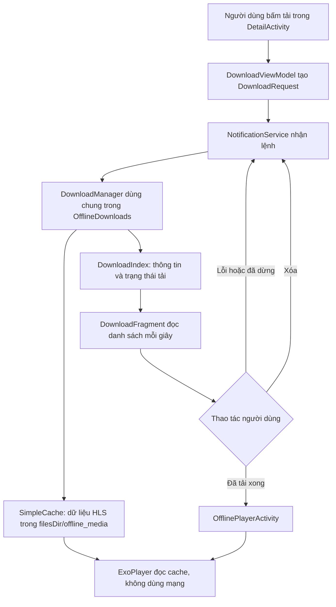

# Logic tải phim và xem offline

Tính năng dùng **`androidx.media3.exoplayer.offline.DownloadManager`** để tải HLS (`.m3u8`) và lưu trong bộ nhớ riêng của ứng dụng. Không chuyển video thành file MP4.

Đây là DownloadManager của Media3, khác với `android.app.DownloadManager` của hệ thống Android.

## 1. Sơ đồ tổng thể



## 2. Các file cần đọc

Các đường dẫn Java/Kotlin dưới đây tính từ `app/src/main/java/com/htdev/movie/htplay/`.

| File | Vai trò |
| --- | --- |
| `detail/DetailActivity.kt` | Nhận thao tác tải tập đang chọn; trình phát chi tiết cũng có thể đọc cache. |
| `home/download/DownloadViewModel.kt` | Tạo yêu cầu tải và gửi lệnh đến service. |
| `home/download/OfflineDownloads.kt` | Giữ DownloadManager và cache dùng chung trong tiến trình app. |
| `service/NotificationService.kt` | DownloadService chạy tải nền và tạo thông báo tiến độ. |
| `home/download/DownloadFragment.kt` | Hiện danh sách, tìm kiếm, xóa, thử lại và mở phim đã tải. |
| `home/download/OfflinePlayerActivity.kt` | Phát bản tải hoàn tất bằng cache, quản lý vòng đời player. |

Các file cấu hình liên quan:

- `app/src/main/AndroidManifest.xml`: khai báo quyền mạng, foreground service, service loại `dataSync` và activity phát offline.
- `app/build.gradle.kts`, `gradle/libs.versions.toml`: các thư viện Media3, gồm module database; bỏ dependency Transformer khỏi app.
- `app/src/main/res/layout/fragment_download.xml`: giao diện danh sách và các trạng thái rỗng.
- `app/src/main/res/layout/item_download.xml`: một dòng tải xuống.

## 3. Từ nút tải đến hàng đợi

### `DetailActivity.onDownloadMovie()`

1. Lấy `selectedEpisode`, tức tập đang được chọn để phát.
2. Nếu chưa có tập hoặc `linkM3u8` trống thì dừng.
3. Gọi `downloadViewModel.downloadEpisode()` với URL đã `trim()` và nhãn gồm tên phim + ID tập.
4. Hiện toast đã thêm vào mục Tải xuống; nếu việc gửi lệnh phát sinh exception thì hiện lỗi.

**Toast này xác nhận đã gửi yêu cầu, không có nghĩa video đã tải xong.** Kết quả thực tế nằm ở trạng thái của DownloadManager.

### `DownloadViewModel.downloadEpisode(url, title)`

Yêu cầu tải chứa:

```kotlin
val request = DownloadRequest.Builder(
    UUID.nameUUIDFromBytes(url.toByteArray(Charsets.UTF_8)).toString(),
    Uri.parse(url)
)
    .setMimeType(MimeTypes.APPLICATION_M3U8)
    .setData(title.toByteArray(Charsets.UTF_8))
    .build()
```

| Trường | Ý nghĩa |
| --- | --- |
| `id` | UUID sinh từ URL. Cùng URL tạo cùng ID để Media3 nhận diện cùng một mục tải. |
| `uri` | URL HLS cần tải. |
| `mimeType` | Chỉ rõ nội dung là HLS, kể cả khi URL không có đuôi `.m3u8`. |
| `data` | Nhãn hiển thị, mã hóa UTF-8; không phải dữ liệu video. |

Sau đó gửi hai lệnh:

```kotlin
DownloadService.sendAddDownload(context, NotificationService::class.java, request, false)
DownloadService.sendResumeDownloads(context, NotificationService::class.java, false)
```

Lệnh đầu thêm/cập nhật mục tải. Lệnh sau bỏ trạng thái tạm dừng chung của manager. Tham số `false` ở đây là tham số `foreground` của lệnh khởi động service, không phải cấu hình tắt thông báo hay cấm service chạy foreground khi đang tải.

ViewModel không sở hữu tác vụ tải nên khi đóng màn chi tiết, `onCleared()` không hủy download như luồng Transformer trước đây.

## 4. DownloadManager và nơi lưu dữ liệu

### `OfflineDownloads.manager(context)`

`OfflineDownloads` là Kotlin `object`. `manager()` có `@Synchronized` để việc khởi tạo dùng chung không tạo nhiều manager/cache khi có lời gọi đồng thời.

Lần gọi đầu tạo:

```text
Application context
    ├── StandaloneDatabaseProvider
    ├── SimpleCache(filesDir/offline_media, NoOpCacheEvictor, database)
    └── DownloadManager(database, cache, HTTP factory, executor)
```

- Dùng application context để không giữ tham chiếu Activity.
- `StandaloneDatabaseProvider` phục vụ dữ liệu quản lý cache và chỉ mục tải.
- `SimpleCache` lưu dữ liệu HLS thành các phần cache do Media3 quản lý.
- `NoOpCacheEvictor` không tự loại bỏ nội dung theo giới hạn dung lượng cache.
- `DefaultHttpDataSource.Factory()` cung cấp kết nối HTTP để tải nội dung.
- Executor có 3 thread; `maxParallelDownloads = 2` giới hạn tối đa 2 mục tải đồng thời. Số thread và số mục tải là hai cấu hình khác nhau.

### Dữ liệu được lưu ở đâu?

Thư mục video được tạo bằng:

```kotlin
File(context.applicationContext.filesDir, "offline_media")
```

Đây là thư mục riêng trong vùng dữ liệu ứng dụng. Không có file `<tên phim>.mp4` để đưa ra Downloads hoặc thư viện ảnh.

Cache chứa nội dung phục vụ phát HLS; `DownloadIndex` giữ thông tin như request, trạng thái và lượng dữ liệu đã tải. Khi mở lại app, màn Tải xuống đọc index thay vì dựa vào danh sách chỉ giữ trong RAM.

Gỡ app hoặc xóa dữ liệu ứng dụng sẽ làm mất bản tải. Bộ nhớ riêng không đồng nghĩa với mã hóa hay bảo vệ DRM; code hiện tại không thiết lập các cơ chế đó.

## 5. Service tải nền và thông báo

`NotificationService` kế thừa `DownloadService` của Media3:

```kotlin
class NotificationService : DownloadService(
    1001,                  // ID thông báo foreground
    1000L,                 // Khoảng cập nhật thông báo: 1 giây
    "offline_downloads",   // ID notification channel
    R.string.app_name,     // Tên channel
    0                      // Không có resource mô tả channel
)
```

Các hàm chính:

- `getDownloadManager()`: trả về manager dùng chung từ `OfflineDownloads`.
- `getForegroundNotification()`: dùng `DownloadNotificationHelper` tạo thông báo tiến độ.
- `getScheduler()`: hiện trả về `null`, chưa có scheduler để chủ động khởi động lại service khi điều kiện tải thay đổi sau khi service đã bị dừng.

Manifest khai báo `INTERNET`, `ACCESS_NETWORK_STATE`, `FOREGROUND_SERVICE`, `FOREGROUND_SERVICE_DATA_SYNC` và `foregroundServiceType="dataSync"`.

Service giúp tải tiếp khi rời màn hình. Không nên hiểu điều này là bảo đảm tải liên tục sau force-stop, khởi động lại máy hoặc mọi trường hợp Android dừng tiến trình. Khi mở mục Tải xuống, code có gọi `DownloadService.start()` để khởi động lại service; lỗi từ lời gọi này hiện được `runCatching` giữ lại mà chưa hiển thị.

## 6. Danh sách tải xuống

### Cập nhật dữ liệu

Trong `DownloadFragment.initView()`:

1. Gắn adapter và sự kiện tìm kiếm.
2. Lấy manager dùng chung và thử khởi động service.
3. Trong `repeatOnLifecycle(STARTED)`, đọc `manager.downloadIndex.getDownloads()` trên `Dispatchers.IO`.
4. Đóng cursor bằng `use`, cập nhật giao diện rồi chờ 1 giây.

Vòng đọc tạm dừng khi view xuống dưới trạng thái `STARTED` và chạy lại khi view hoạt động trở lại. `viewLifecycleOwner.lifecycleScope` hủy coroutine khi view bị hủy.

### Trạng thái và thao tác

| Trạng thái Media3 | Hiển thị | Bấm vào dòng |
| --- | --- | --- |
| `STATE_COMPLETED` | Đã tải xong | Mở `OfflinePlayerActivity`, truyền `download_id`. |
| `STATE_DOWNLOADING` | Phần trăm đang tải | Không xử lý. |
| `STATE_FAILED` | Tải thất bại | Gửi lại request và lệnh resume. |
| `STATE_STOPPED` | Đã dừng | Gửi lại request và lệnh resume. |
| `STATE_REMOVING` | Đang xóa | Không xử lý. |
| Trạng thái còn lại | Đang chờ tải | Không xử lý. |

Tiến độ chưa xác định được chặn về tối thiểu `0%` bằng `coerceAtLeast(0f)`. Dung lượng hiển thị là số byte đã tải chia `1048576.0`, không phải tổng dung lượng dự kiến.

Nút xóa gửi `DownloadService.sendRemoveDownload()` bằng ID. Media3 xử lý xóa dữ liệu tải; giao diện phản ánh thay đổi ở lần đọc index tiếp theo.

### Tìm kiếm và trạng thái rỗng

`renderDownloads()` lọc nhãn trong `request.data` bằng `contains(query, ignoreCase = true)`.

- Không có mục tải: hiện `llEmpty`.
- Có mục tải nhưng không khớp tìm kiếm: hiện `lnEmptySearch`.
- Có kết quả: hiện RecyclerView.

Adapter hiện dùng `notifyDataSetChanged()` mỗi lần cập nhật. Khi hủy view, fragment gỡ adapter khỏi RecyclerView.

## 7. Phát offline

`OfflinePlayerActivity` nhận `download_id`, rồi đọc lại mục tải từ index trên luồng IO.

Chỉ khi mục tồn tại và có trạng thái `STATE_COMPLETED` thì activity tạo player. Nếu chưa sẵn sàng, activity hiện toast và đóng.

```kotlin
DefaultMediaSourceFactory(
    OfflineDownloads.dataSource(this, offlineOnly = true)
)
```

`dataSource()` cấu hình:

```kotlin
CacheDataSource.Factory()
    .setCache(downloadCache)
    .setCacheWriteDataSinkFactory(null)
    .setUpstreamDataSourceFactory(null) // Khi offlineOnly = true
```

- Đọc cùng cache đã dùng để tải.
- Không ghi thêm cache trong lúc phát.
- Không có nguồn mạng dự phòng trong chế độ offline. Nếu cache thiếu/hỏng, player không âm thầm tải phần thiếu từ mạng.

`download.request.toMediaItem()` chuyển request đã lưu thành MediaItem để giữ URI và cấu hình liên quan cho player.

### Vòng đời player

- `onCreate()`: khôi phục vị trí và trạng thái phát từ `savedInstanceState` nếu có.
- `onStart()`: đọc mục tải, tạo `PlayerView`, tạo ExoPlayer, seek đến vị trí nhớ và chuẩn bị phát.
- `onSaveInstanceState()`: lưu vị trí và trạng thái play/pause.
- `onStop()`: nhớ vị trí hiện tại, giải phóng player.

Vị trí này phục vụ vòng đời của activity, chưa được lưu thành lịch sử xem offline lâu dài sau khi đóng rồi mở một activity mới.

## 8. Trình phát trong màn chi tiết

`DetailActivity` cũng tạo ExoPlayer qua `OfflineDownloads.dataSource(this)`, nhưng dùng `offlineOnly = false` mặc định.

Luồng đọc là:

```text
Có dữ liệu trong cache → đọc cache
Thiếu dữ liệu          → đọc HTTP
```

Vì `setCacheWriteDataSinkFactory(null)`, xem online không tự tích lũy thêm video vào cache. Việc lưu offline vẫn do DownloadManager thực hiện khi người dùng bấm tải.

## 9. Giới hạn hiện tại cần biết khi sửa tiếp

- ID dựa trên toàn bộ URL: URL thay đổi token/query có thể tạo mục tải mới dù vẫn là cùng một tập.
- Chưa có giao diện chọn chất lượng/track bằng DownloadHelper; request hiện không đặt bộ lọc stream key.
- Chưa có nút tạm dừng riêng hoặc chọn chỉ tải qua Wi-Fi.
- Chưa có scheduler khởi động lại service tự động như mô tả ở trên.
- Chưa kiểm tra dung lượng trống hoặc đặt quota trước khi tải; cache không tự dọn theo dung lượng.
- Danh sách dùng polling mỗi giây; chưa dùng listener kết hợp DiffUtil để cập nhật từng dòng.
- Nhãn lưu mới chỉ là tên phim + ID tập; ảnh trong layout chưa được bind theo metadata của bản tải.
- Màn offline chưa có giao diện lỗi riêng khi cache thiếu hoặc player phát lỗi.

## 10. Thứ tự đọc code gợi ý

1. `DetailActivity.onDownloadMovie()` — điểm bắt đầu.
2. `DownloadViewModel.downloadEpisode()` — request gồm những gì.
3. `OfflineDownloads.manager()` — ai quản lý tải, dữ liệu nằm đâu.
4. `NotificationService` — tải chạy qua service thế nào.
5. `DownloadFragment.initView()` và `renderDownloads()` — cách UI lấy trạng thái.
6. `OfflinePlayerActivity.onStart()` và `OfflineDownloads.dataSource()` — cách phát dữ liệu đã lưu.
